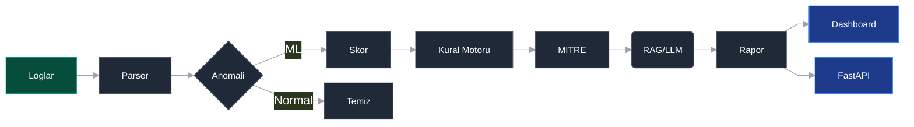

# SentinelAI - AI-Powered Cybersecurity Analyst

Güvenlik operasyon merkezlerinde (SOC) analistlerin günde binlerce log arasında kaybolmasını engellemek ve yanlış alarm (False Positive) yorgunluğunu azaltmak için geliştirilmiş, yapay zeka destekli bir log analiz ve tehdit tespit platformu prototipi.

## Projenin Mühendislik Hikayesi (Neden Yaptım?)

Güvenlik sistemlerinde "her şeyi yapay zekaya bırakmak" büyük bir risktir (halüsinasyon, yanlış alarmlar). Bu projede **Hibrit (Kural + ML)** mimarisi benimsenmiştir:
- **ML Katmanı:** Anomali tespiti için Isolation Forest ve PyTorch kullanılmıştır.
- **Kural Katmanı:** Tehdit sınıflandırması (MITRE ATT&CK) deterministik Python kuralları ile yapılır. Böylece LLM'in ürettiği metinlerin sistemin aksiyonlarını (örneğin IP bloklama) etkilemesi engellenmiştir.
- **AI & RAG:** Analiste rapor sunarken LLM'den faydalanılır ancak aksiyon önerileri (SOC Playbook) sabit kurallara dayanır.

## Öne Çıkan Başarılar ve Metrikler

- **Yanlış Alarm Optimizasyonu:** Başlangıçta "Gece girişi" kuralı 261 yanlış alarm üretirken, kullanıcı davranış analitiği (baseline) eklenerek bu sayı **12'ye** düşürüldü.
- **Model Performansı:** Test veri setinde (2100 log) **Precision: 0.893**, **Recall: 1.000** ve **F1-Score: 0.943** elde edildi.

## Mimari ve Veri Akışı



## Klasör Yapısı

```text
SentinelAI/
├── notebooks/          # 5 aşamalı geliştirme süreci (Parser, Anomaly, RAG, Dashboard, Full-Stack)
├── reports/            # Model değerlendirme ve kod inceleme (code review) raporları
├── app.py              # Streamlit Dashboard Arayüzü
├── api.py              # FastAPI Backend Servisi
├── Dockerfile          # Konteyner yapılandırması
├── requirements.txt    # Bağımlılıklar
└── README.md
```

## Kurulum ve Çalıştırma

Bu proje modüler bir prototip olarak geliştirilmiştir. Farklı bileşenleri çalıştırmak için:

1. Depoyu klonlayın:
   ```bash
   git clone https://github.com/almina-nur/SentinelAI.git
   cd SentinelAI
   ```

2. Gerekli kütüphaneleri yükleyin:
   ```bash
   pip install -r requirements.txt
   ```

3. **Dashboard'u başlatmak için:**
   ```bash
   streamlit run app.py
   ```

4. **FastAPI Backend'i başlatmak için (PostgreSQL gerektirir):**
   ```bash
   uvicorn api:app --reload
   ```

*(Not: Docker entegrasyonu henüz tam olarak tamamlanmamış olup, konteyner yapılandırması gelecek aşamada `docker-compose` ile birleştirilecektir.)*
